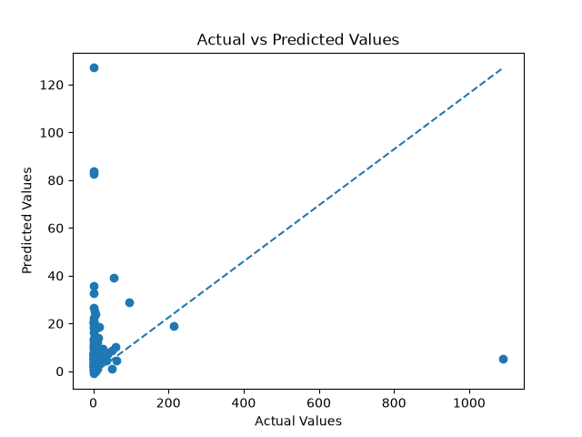
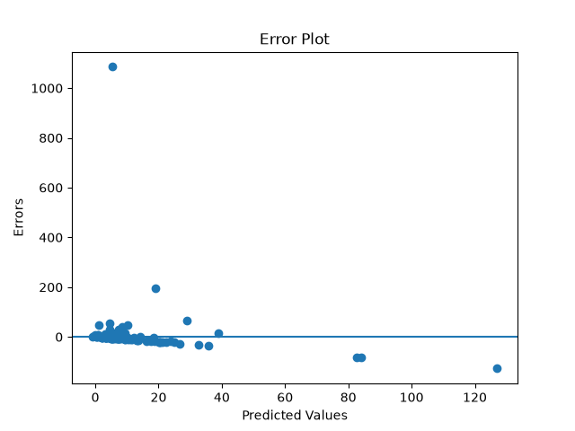

## XGBOOST Regression from scratch

This project implements XGBoost regression from scratch without relying on machine learning libraries for the core algorithm.
The implementation is validated by comparing its performance with xgb's `XGBRegressor` on the student score dataset.

### Features 

* XGBoost regression implemented from scratch.
* weight calculation
* Threshold generation 
* Data splitting 
* gain calculation
* Best gain, gradient, hessian,feature,thresholds
* Recursive tree construction
* Pure-node detection
* weight based prediction
* max_depth for controlling tree growth
* intial prediction
* calculating gradient,hessian
* prediction upadation
* recalculating gradient,hessian values.
* store trees
* predict on test data using trained trees.

### Dataset

forestfires.csv

Source:

UCI Machine Learning Repository

dataset had many outliers. it is hard get better performance with basic implementation.

### Algorithm

XGBoost is supervised machine learning algorithm based on gradients, hessian, regularization.

The algorithm calculates the continues target value by continuesly creating trees with correction of previous trees without adding too much split complexity.

### Prediction 

```text
Fm(x) = Fm-1(x) + ηTm(x)
```
* Fm−1(x) = previous ensemble prediction
* Tm(x) = new tree's prediction
* η = learning rate

### Gradient

```text
dL/dF = F - y
- dL/dF = y - F
```

### Hessian 

### Gradient

```text
dg/dF = F 
```

### weight
### Gradient

```text
w = -G / (H + λ)
G = sum(g)
H = sum(h)
λ = regularization parameter
```

## Implementation

* Loaded student score dataset.
* selected the useful features.
* modified the target.
* split the data into training and testing.
* Calculated weight for each leaf node.
* split based on thresholds.
* Calculated gain based on candidate split.
* Selected the split with maximum gain.
* Recursively constructed the decision tree.
* Used the mean target value as the prediction at leaf nodes.
* Added maximum depth
* created intial predictions.
* calculate the gradients and hessian.
* update the prediction.
* recaluculating gradients and hessians.
* use the stored trees to predict for unseen data.
* check the accuracy.
* evaluated using precison,recall,confusion matrix.
* compared with libraries implementation.
* Added visualization.

### from scratch

```text
MAE: 19.877224009352723
MSE: 12193.378830259255
RMSE: 110.42363347698378
R2 Score: -0.02464613699730589
```

### Scikit-learn

```text
MAE: 25.536227162067707
MSE: 12243.797335268464
RMSE: 110.65169377496426
R2 Score: -0.03868717487581419

```

### Visualizations

### Actual vs prediction



### Residual plot



## Folder Structure

```text
XGBoost_regression/
│
├── plots/
│   ├── actual_vs_prediction.png
│   |-- residual_plot.png
├── from_scratch.py
├── sklearn_model.py
├── visualization.py
└── README.md
```

### What I learned

* implemented XGBoost regression from scratch.
* Learned how to train model using xgboost algorithm.
* Learned how xgboost control complexity while correcting trees.
* Learned how gradients, hessian used in xgboost.
* Learned to get accurate model better training data also important as better algorithm.
* Noticed how manual implementation takes more time run program with many iterations and samples.
* Learned model performance mainly depends on training data.